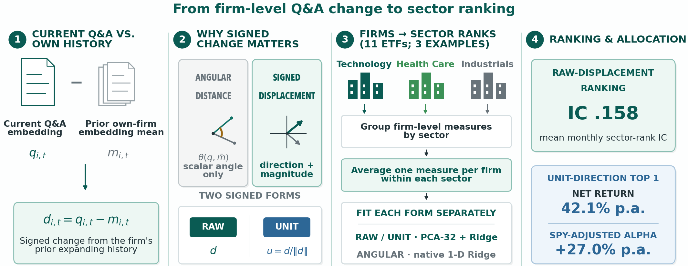

# CallRank

Code, aggregate results, and public replay inputs for the ICAIF '26 paper
**CallRank: Isolating What Changed in Earnings-Call Q&A for Sector Ranking and
Cost-Adjusted Alpha** ([doi:10.1145/3858063.3858800](https://doi.org/10.1145/3858063.3858800)).

Authors: Doohwi Cha, Minsuk Sung, Seunghan Son, Juyeong Lee, Donghwa Seo,
Minjae Lee, Hyeonjun Yeo, and Yoontae Hwang.



## Summary

CallRank measures what changed in a firm's earnings-call Q&A against the
firm's own expanding history. The signed displacement d keeps the direction
and size of the change; CallRank uses it as is (raw displacement) or scaled to
unit length (unit direction u = d/‖d‖). Firm vectors are averaged within each
sector, and a fixed PCA/Ridge head ranks the month's sector ETFs.

- **Fixed head.** The ranking heads use only outcomes completed by December 1,
  2020 and stay fixed for the 24 eligible monthly decisions that follow the
  encoder's public revision (signal months November 2023 – March 2026).
- **Ranking.** Raw displacement ranks sectors: its mean monthly sector-rank IC
  is .158 (Newey–West p = .007; calendar-shift p = .044). An angular-distance
  control does not (IC −.088).
- **Allocation.** In a historical backtest net of 5 bp one-way costs
  (December 1, 2023 – June 2, 2026), the unit-direction Top 1 allocation (each
  month's highest-ranked eligible sector ETF, held for 42 trading days in
  overlapping monthly sleeves) earns a 42.1% annualized net return versus
  24.0% for SPY, with a SPY-adjusted alpha of 27.0%.

IC (information coefficient) is the mean of the monthly Spearman correlations
between predicted and realized sector ranks. See the [Disclaimer](#disclaimer).

## Quick start: validate without licensed data

The checks need Python 3.12 or newer, because the pinned numpy and SciPy
versions do not install on Python 3.11 or older. `requirements-validation.txt`
pins the environment used for the release checks. Its matplotlib and Pillow
versions are needed for the figure step to reproduce the committed files byte
for byte.

```bash
git clone https://github.com/DoohwiCha/CallRank-ICAIF2026.git
cd CallRank-ICAIF2026
python3 -m venv .venv            # use a Python 3.12+ interpreter
source .venv/bin/activate
python -m pip install --upgrade pip
python -m pip install -r requirements-validation.txt
python scripts/reproduce_public_inputs.py
python scripts/build_manuscript_figures.py
python scripts/recompute_published_results.py
python scripts/recompute_unsigned_diagnostic.py
python scripts/validate_release.py
python -m unittest discover -s tests -v
```

**What a successful run looks like**
- Every command finishes without error.
- `validate_release.py` prints 63 PASS lines, and the unit tests report OK.
- `build_manuscript_figures.py` rewrites Figures 2 and 4 in
  `aggregate_results/figures/`. With the pinned environment, the rewritten
  files are identical to the committed ones.
- After dependencies are installed, the checks need no API key, proprietary
  file, or network access.

**Where to run the checks**
- Use an unmodified clone with `main` or a release tag checked out.
- `validate_release.py` inspects every file under the repository root except
  `.git/`, `.venv/`, `__pycache__/`, and `.pytest_cache/`. Keep other virtual
  environments, licensed inputs, and results outside the clone.
- `.gitattributes` disables line-ending conversion, so a fresh clone on any
  platform checks out the bytes recorded in the manifests. A clone made before
  this release with `core.autocrlf=true` (the Git for Windows default) keeps
  its converted files after `git pull`; re-clone it, or run
  `git rm -r -q --cached . && git reset --hard` once (this discards local
  changes).

**What each check covers**
- `reproduce_public_inputs.py` refits the six raw-displacement and
  unit-direction PCA-32/Ridge heads (λ = 10⁴) from public train-only
  standardized Gram matrices. It then recomputes evaluation scores, monthly
  sector-rank ICs, Top 1 and Bottom 1 selections, overlapping
  42-trading-day portfolio returns, and alpha. These sufficient statistics
  preserve the fixed-head calculation without releasing call text or firm
  vectors.
- `recompute_published_results.py` recomputes, from the aggregate tables and
  paths:
  - the released risk and alpha statistics and long-lag inference
  - cost sensitivities and randomization p-values
  - the identity-control checkpoints
- `recompute_unsigned_diagnostic.py` recomputes the unsigned-displacement
  statistics from released sector-level scores (see below).
- `validate_release.py` covers:
  - every aggregate-file hash and the public-input allowlist
  - the three-sleeve accounting rule and the stored raw-robustness estimates
  - a scan of the current tree's text files for credentials, local user paths,
    email addresses, and stale version labels, and of its PDF and PNG figures
    for email addresses and macOS user paths
  - a check that every commit reachable from `HEAD` uses the declared
    maintainer identity

Some stored tables have no generating script in this release; most were
produced from licensed inputs. The checks verify their hashes, and
`recompute_published_results.py` also checks the entries marked "compared"
against fixed reference values:
- `raw_robustness.csv` (the Figure 4 rows other than the main estimate;
  compared)
- `encoder_summary.csv` (Table 2, Panel B)
- the Loughran–McDonald (LM) tone-baseline path in
  `baseline_portfolio_daily_returns.csv` (its summary row is recomputed from
  the path)
- `random_sector_null.csv` (§5.4; p-values recomputed from the stored null)
- `pca_ridge_sensitivity.csv` (§3.5 head grid; its 16 cells can also be refit
  from the public `unit_*.npz` inputs with the functions in
  `scripts/reproduce_public_inputs.py`)
- `training_correction_ablation.csv` (§5.1 ledger corrections; compared)
- `grouped_signal_month_exclusions.csv`, the `top1_ex_utilities` rows of the
  portfolio files, and `static_sector_benchmark.csv` (§5.4 stress tests and
  static XLU; compared)
- `financial_controls.csv` (§5.5 unit-direction firm-count partial IC, .073)
- `leave_one_sector_out.csv` and `held_out_sector_tests.csv` (unit-direction
  diagnostics)

Rebuilding the encoder features and the upstream firm-conditioned inputs
requires licensed data (see [Licensed-input workflow](#licensed-input-workflow)).

## Repository layout

| Path | Contents |
| --- | --- |
| `aggregate_results/` | Aggregate tables, daily strategy paths, and the paper figures; its [README](aggregate_results/README.md) maps each file to the paper |
| `config/` | Frozen model, evaluation, and identity-control settings |
| `data/` | Licensed-input schemas, the clean-room boundary, and the public DGS3MO series |
| `diagnostics/unsigned_displacement_20261011/` | Sector-level scores and replay for the unsigned-displacement diagnostic |
| `provenance/` | Release-file hashes and validation records |
| `public_inputs/` | Sector-level sufficient statistics and market inputs for the public replay |
| `scripts/` | Feature, target, model, portfolio, figure, and validation code |
| `tests/` | Synthetic leakage, masking, and accounting tests |
| `requirements-validation.txt` | Exact pins for the public checks |
| `requirements.txt` | Compatible version ranges for the licensed workflow |
| `requirements-embedding.txt` | Embedding and identity-control environment (Python 3.12 or 3.13 on Linux x86_64/aarch64 with glibc 2.28+, Windows x64, or macOS 14+ on Apple silicon, the platforms with torch 2.12.1 wheels; includes `requirements.txt`) |
| `CITATION.cff`, `LICENSE`, `CODE_AND_DATA_NOTICE.md` | Citation metadata, MIT license, and data terms |
| `PUBLIC_RELEASE.json`, `RELEASE_STATUS.json` | Release metadata |

## Method in brief

For each eligible firm-month, the pipeline:

1. embeds non-overlapping Q&A-side passages with the frozen Industry-BERT-SEC
   encoder, which is never fine-tuned on returns:
   - text: the first 9,000 characters of Q&A-side text
   - passages: 128, 160, and 200 words, each with a fixed instruction prefix
   - encoder: `llmware/industry-bert-sec-v0.1`, public revision dated
     October 16, 2023; 768 dimensions
2. subtracts the expanding mean of the same firm's earlier Q&A embeddings (at
   least two prior firm-months) to form the signed displacement d;
3. averages either d (raw displacement) or its unit direction u = d/‖d‖ across
   eligible firms within each sector;
4. fits a separate training-only standardization, PCA (32 components), and
   Ridge (λ = 10⁴) head for each signed form and passage length, using
   outcomes completed by December 1, 2020, and keeps those coefficients fixed
   during evaluation; and
5. averages within-month percentile ranks across the three passage lengths.

The target is the within-month percentile rank of the next 42-trading-day
sector ETF return in excess of SPY.

**Signed forms**
- Raw displacement keeps magnitude and gives the larger IC point estimate.
- Unit direction fixes each issuer's contribution norm before sector averaging
  and is used for the reported allocation.
- Their paired IC difference is not significant (Newey–West p = .200), so
  neither form is claimed to dominate.
- Angular distance is the scalar movement-size control.

**Allocation**
- Each month, a new sleeve buys the highest-scored eligible sector ETF (Top 1)
  on the first trading day after month-end and holds it for 42 trading days.
- Up to three monthly sleeves overlap, so the portfolio holds up to three
  distinct sector ETFs when the monthly leaders differ; capital is split
  equally across active sleeves. Months with fewer than six scored sectors
  open no new sleeve.
- All paths pay 5 bp per unit of one-way turnover.
- Bottom 1 (the lowest-scored ETF) and the 200% gross Top 1–Bottom 1 spread are
  diagnostics. The spread pays turnover costs on both legs but no borrow or
  financing charges.

**Code and configuration labels**
- `firm_conditioned_qa_raw` and "raw signed residual" denote raw displacement d.
- `firm_conditioned_qa_direction` and "L2-normalized signed residual" denote
  unit direction u.
- `firm_conditioned_qa_distance` denotes angular distance.
- In `config/frozen_config.json`, `data_integrity.evaluation_exact_official_date`
  (2,848) and `data_integrity.evaluation_official_month` (1,756) count
  Table 1's day-level externally verified and month-only, filing-consistent
  calls. Despite the key names, the month-only class rests on agreement between
  the provider month and issuer- and period-matched SEC filings.
- The frozen configuration otherwise keeps its original wording.

## Paper results and released sources

Files are in `aggregate_results/` unless a path from the repository root is
shown. Brackets follow the paper:
- [Newey–West p / calendar-shift p] for ICs
- [paired Newey–West p] for paired gaps
- [NW(5)/NW(42) p] for daily alphas

Calendar-shift p-values use 20,000 paths (2,000 for the encoder comparison).

| Evidence | Value in the paper | Released source |
| --- | --- | --- |
| Sector ranking (Table 2) | Raw displacement IC .158 [.007/.044]; unit direction .100 [.055/.099]; raw–unit paired difference p = .200 | `representation_results.csv`, `circular_shift_tests.csv`, `paired_ic_tests.csv` |
| Identity mask (Table 3) | Raw displacement IC .191 [.002/.006]; unit direction .183 [<.001/.004] | `identity_control_tests.csv` |
| Matched body swap (Table 3) | Paired correct–placebo gap .195 [.020] for raw displacement and .177 [.027] for unit direction | `identity_control_tests.csv` |
| Firm matching (Figure 2) | Own-firm unit-direction IC .135 (160-word passages; Newey–West p = .013) versus 1,000 same-sector wrong-firm draws (p = .005); Top-1 issuer retrieval 41.4% for current Q&A versus 3.2% for unit direction | `history_reference_tests.csv`, `wrong_firm_placebo_draws.csv`, `issuer_identity_probe.csv` |
| Unit-direction Top 1 (Table 4, Figure 3) | 42.1% annualized net return versus 24.0% for SPY; SPY-adjusted alpha 27.0% [.003/.004]; maximum drawdown 9.9% | `portfolio_summary.csv`, `alpha_lag_sensitivity.csv`, `portfolio_daily_returns.csv` |
| Overlapping sleeves (§4.2) | Up to three monthly Top 1 sleeves are active at once; capital is split equally across active sleeves | `portfolio_daily_returns.csv`, `config/frozen_config.json` |
| Cost sensitivity (§5.4) | At 20 bp one way: 39.6% annualized net return, 24.8% SPY-adjusted alpha, and 10.7% maximum drawdown | `cost_sensitivity.csv` |
| Raw robustness (Figure 4) | All nine estimates are positive; six 95% Newey–West intervals exclude zero; reported EPS/revenue partial IC .171; at least eight prior firm-months .144 | `raw_robustness.csv`, `aggregate_results/figures/callrank_robustness.pdf` |
| Sector concentration (§5.4) | Top 1 selections span ten sectors and change in 16 of 23 transitions; static XLU earns 17.4% annualized versus 42.1% for CallRank Top 1 | `top1_selection_frequency.csv`, `aggregate_summary.json`, `static_sector_benchmark.csv` |

**Exact ties (§4.2).**
- A fixed canonical sector-key order resolves exact score ties without using
  returns.
- In the April 2025 decision, the two highest unit-direction ensemble scores
  are equal in exact arithmetic. Holding both tied sectors yields a 41.9%
  annualized net return and 26.9% SPY-adjusted alpha.
- That sensitivity uses licensed capitalization weights and is cited from the
  paper. The [aggregate README](aggregate_results/README.md#exact-ties)
  explains how the released tie rows relate to it.

**Values not stored in this release.** Four statistics in the paper's text
need licensed firm-level rows or capitalization:
- the 94.7% share of eligible firm-months with at least eight prior
  firm-months (§5.5)
- the .055 correlation between history count and displacement norm (§5.5)
- the participation counts over the 240 scored sector-months: median 14
  eligible contributing firms; 13 single-contributor cells (§5.1)
- the capitalization-weighted exact-tie sensitivity above

## Identity-controlled mechanism tests

The release contains the exact aggregate replay and the frozen text
transformation used for the two controls in the paper's Table 3:

- **Full-pipeline identity mask.** Company names, tickers, speaker names, and
  broad named-entity spans are replaced in the Q&A text before embeddings are
  rebuilt. Training and evaluation are both transformed, and both signed heads
  are refit using the same pre-2021 outcome boundary.
- **Matched identity-shell body swap.** Each target call receives the same
  company, ticker, and current-speaker shell in both arms. One arm appends the
  target's masked Q&A body; the other appends a deterministic, return-blind,
  same-month cross-sector donor body. The paired monthly IC difference isolates
  the incremental information in the correctly matched body conditional on the
  common shell.

The mask and the body swap are distinct controls, not before/after rows. The
released 24-month ICs and 20,000-path calendar-shift nulls replay the reported
identity-control results offline. Rebuilding the masked text requires licensed
inputs (see [Licensed-input workflow](#licensed-input-workflow)).

## Unsigned-displacement diagnostic

The [`diagnostics/unsigned_displacement_20261011/`](diagnostics/unsigned_displacement_20261011/)
folder contains the post-review diagnostic reported in the paper's §5.2 and
Table 2 on the already observed evaluation period.
- **What changes.** Before sector averaging, each firm's signed displacement d
  is replaced by abs(d), or its unit direction u by abs(u), element by element
  in the fixed encoder basis.
- **What stays the same.** Both signed/unsigned comparisons keep the same
  PCA-32/Ridge head specification.
- **Extra arm.** The folder also keeps a one-component raw-displacement
  diagnostic.

| Ensemble | IC | NW(1) p | NW(2) p | Calendar-shift p |
| --- | ---: | ---: | ---: | ---: |
| Raw displacement | .158 | .007 | .002 | .044 |
| Unsigned raw \|d\| | −.023 | .795 | .794 | .877 |
| Unit direction | .100 | .055 | .030 | .099 |
| Unsigned unit \|u\| | .031 | .711 | .686 | .389 |
| Raw displacement, one PCA component | .017 | .750 | .698 | .430 |

Table 2 reports the IC, Newey–West (lag 1) p, and calendar-shift p for the
first four rows. The NW(2) column and the one-component row are additional
repository diagnostics.

**Paired gaps**
- Raw minus unsigned: .181 (NW(1) p = .032; NW(2) p = .038; paired t
  p = .065).
- Unit minus unsigned: .070 (NW(1) p = .527; NW(2) p = .489; paired t
  p = .525). The paper reports only the NW(1) p for this gap.

All p-values are unadjusted. This is a post-review diagnostic with 24 eligible
months, not a new holdout or independent confirmation. The protocol was frozen
locally before these new fits; this does not constitute an external
preregistration.

**What the folder supplies and replays**
- Contents: sector-level passage-model scores, ensemble scores, monthly ICs,
  all five 20,000-path shift distributions, and paired results.
- The replay recomputes statistics from these scores. It does not refit
  unsigned heads or reconstruct firm features.
- The six-head raw/unit sufficient-statistic refit is a separate workflow.
- The folder contains no transcript or firm embedding.

```bash
python scripts/recompute_unsigned_diagnostic.py
```

## Licensed-input workflow

The exact schemas are in [`data/README.md`](data/README.md).
- **Placeholders.** In the commands below, `LICENSED` is the directory that
  holds your licensed files and `WORK` is a writable scratch directory outside
  this clone; set both first.
- **Ledger hash.** `validate_canonical_ledger.py` requires the frozen ledger
  hash by default. Add `--skip-frozen-hash` to run only the structural checks
  on a ledger rebuilt from another licensed source.

A licensed user first builds the ordinary CallRank inputs:

```bash
LICENSED=/path/to/licensed-inputs
WORK="$HOME/callrank-work"
python -m pip install -r requirements-embedding.txt
python scripts/validate_canonical_ledger.py \
  --ledger "$LICENSED/cleanroom_event_map.parquet"
python scripts/build_embeddings.py \
  --input "$LICENSED/cleanroom_call_sections.parquet" \
  --output-dir "$WORK/original"
python scripts/build_targets.py \
  --prices "$LICENSED/sector_etf_adjusted_close.csv" \
  --months "$WORK/original/call_qa_all160.parquet" \
  --output "$WORK/original/targets.csv"
cp "$LICENSED/sector_etf_adjusted_close.csv" "$WORK/original/sector_etf_adjusted_close.csv"
cp "$LICENSED/pit_sector_market_caps.csv" "$WORK/original/pit_sector_market_caps.csv"
python scripts/run_all.py \
  --data-dir "$WORK/original" \
  --results-dir "$WORK/original-results"
```

**Identity-control builder**
- With `--frozen-inputs`, `scripts/build_identity_controls.py` calls the frozen
  masking engine in `scripts/identity_masking.py`. It builds all three
  licensed-text variants from:
  - the canonical capped Q&A bytes
  - historical issuer metadata
  - the participant-pair roster
- `scripts/compare_identity_controls.py` then compares completed fixed-head
  evaluations.
- Without `--frozen-inputs`, the builder offers a reduced-alias path for
  licensed sources that hold only company, ticker, and speaker alias cells.
  That path is a portable reference implementation; it is not claimed to
  recreate the paper's masked corpus byte for byte.
- The exact schemas and transformation boundary are in
  [`data/README.md`](data/README.md),
  [`data/IDENTITY_MASKING_PROTOCOL.md`](data/IDENTITY_MASKING_PROTOCOL.md), and
  [`config/identity_control_protocol.json`](config/identity_control_protocol.json).

To rebuild the reported identity controls, run the following steps in the same
shell session. `requirements-embedding.txt` above already installs the pinned
spaCy model (`en_core_web_sm` 3.8.0).
1. Build the three transformed section tables from the frozen licensed-input
   contract.
2. Embed each table without reapplying the ordinary character cap.
3. Evaluate each embedding set with the same targets, prices, capitalization,
   and fixed-head configuration.
4. Compare the three evaluations with `scripts/compare_identity_controls.py`.

```bash
python scripts/build_identity_controls.py \
  --frozen-inputs \
  --sections "$LICENSED/identity_control_call_sections.parquet" \
  --pair-rosters "$LICENSED/conditional_qa_pairs.parquet" \
  --historical-metadata "$LICENSED/dated_issuer_metadata.parquet" \
  --output-dir "$WORK/identity-sections" \
  --spacy-model en_core_web_sm \
  --seed 20260804

for arm in full_identity_mask correct_body donor_body; do
  python scripts/build_embeddings.py \
    --input "$WORK/identity-sections/${arm}.parquet" \
    --output-dir "$WORK/${arm}" \
    --preprocessed-identity-control
  cp "$WORK/original/targets.csv" "$WORK/${arm}/targets.csv"
  cp "$LICENSED/sector_etf_adjusted_close.csv" "$WORK/${arm}/sector_etf_adjusted_close.csv"
  cp "$LICENSED/pit_sector_market_caps.csv" "$WORK/${arm}/pit_sector_market_caps.csv"
  python scripts/run_core.py \
    --data-dir "$WORK/${arm}" \
    --results-dir "$WORK/${arm}-results" \
    --randomizations 20000 \
    --random-seed 20260804
done

python scripts/compare_identity_controls.py \
  --masked-results "$WORK/full_identity_mask-results" \
  --correct-results "$WORK/correct_body-results" \
  --donor-results "$WORK/donor_body-results" \
  --output "$WORK/identity_control_tests.csv"
```

**What the identity transformation checks**
- It never reads returns, targets, prices, or market capitalizations.
- It verifies:
  - the original capped-Q&A hashes and word counts
  - the frozen alias-registry checkpoints and residual-alias coverage
  - one-to-one cross-issuer/cross-sector donor assignment
  - identical paired identity shells

**What the model runner enforces**
- the pre-2021 fitting boundary
- target-key alignment and prior-only firm history
- capitalization timing
- the six-sector monthly eligibility rule that yields the 24 reported
  decision months

**Other entry points**
- `scripts/run_identification_tests.py` rebuilds the Figure 2 tables
  (`history_reference_tests.csv`, `wrong_firm_placebo_draws.csv`,
  `issuer_identity_probe.csv`, `identification_expansion_summary.json`) and the
  reported-earnings diagnostic `structured_news_tests.csv` from licensed inputs
  (`--event-map`, `--targets`, `--authoritative-predictions`, `--earnings`,
  `--embedding-128`, `--embedding-160`, `--embedding-200`, and
  `--output-dir`; the earnings schema is in
  [`data/README.md`](data/README.md#reported-earnings-input)).
- `scripts/prepare_sections.py` splits a licensed transcript snapshot into
  prepared and Q&A-side sections, and `scripts/build_pit_sector_labels.py`
  applies dated index membership and sector labels.
- `scripts/mask_identity_corpus.py`, `scripts/build_identity_body_placebo.py`,
  and `scripts/compare_identity_control_ics.py` are helper modules of
  `build_identity_controls.py` and `compare_identity_controls.py`.
- `scripts/update_aggregate_manifest.py` refreshes
  `aggregate_results/aggregate_manifest.json` after an aggregate file changes.

## Data and license

- **Code license.** The MIT license in [`LICENSE`](LICENSE) covers the source
  code in this repository only. It grants no rights to transcripts,
  membership, capitalization, provider prices, or data derived from them.
- **What is excluded.** The release contains no transcript, call-level,
  firm-level, issuer-level, membership, capitalization, or holding row, and no
  data file contains an issuer identifier. Apart from synthetic test fixtures,
  the only issuer tickers in the code are the public GICS reclassification
  rules in `scripts/build_pit_sector_labels.py`, which its unit tests also use.
- **Derived data that is included.** Aggregate result tables and paths, the
  sector-level scores in `diagnostics/`, and the normalized market indices in
  `public_inputs/` are included only so readers can check the reported
  results.
- **Third-party series.** Factor, yield, and market series keep their original
  terms (see [`CODE_AND_DATA_NOTICE.md`](CODE_AND_DATA_NOTICE.md)).
- **Backtests.** All portfolio results are historical backtests.

## Citation

Doohwi Cha, Minsuk Sung, Seunghan Son, Juyeong Lee, Donghwa Seo, Minjae Lee,
Hyeonjun Yeo, and Yoontae Hwang. 2026. CallRank: Isolating What Changed in
Earnings-Call Q&A for Sector Ranking and Cost-Adjusted Alpha. In 7th ACM
International Conference on AI in Finance (ICAIF '26), November 14–17, 2026,
Milan, AA, Italy. ACM, New York, NY, USA, 9 pages.
https://doi.org/10.1145/3858063.3858800

```bibtex
@inproceedings{cha2026callrank,
  author    = {Doohwi Cha and Minsuk Sung and Seunghan Son and Juyeong Lee and
               Donghwa Seo and Minjae Lee and Hyeonjun Yeo and Yoontae Hwang},
  title     = {{CallRank}: Isolating What Changed in Earnings-Call {Q\&A} for
               Sector Ranking and Cost-Adjusted Alpha},
  booktitle = {7th ACM International Conference on AI in Finance (ICAIF '26)},
  year      = {2026},
  publisher = {ACM},
  address   = {New York, NY, USA},
  numpages  = {9},
  isbn      = {979-8-4007-3087-0},
  doi       = {10.1145/3858063.3858800}
}
```

GitHub's "Cite this repository" button uses [`CITATION.cff`](CITATION.cff).

## Disclaimer

The views expressed are solely those of the authors and do not represent EY
Consulting, Mirae Asset Securities, or DS Investment & Securities. The authors
are responsible for any errors or omissions. This repository is for academic
purposes only and does not constitute investment advice, a recommendation,
solicitation, or an offer to buy or sell financial products or securities.
